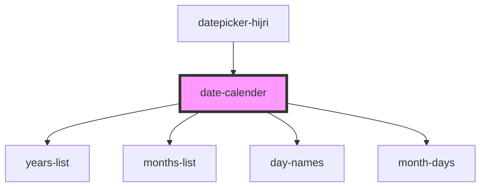

# date-calender

<!-- Auto Generated Below -->

## Properties

| Property                | Attribute                  | Description       | Type     | Default           |
| ----------------------- | -------------------------- | ----------------- | -------- | ----------------- |
| `bgcolor`               | `bgcolor`                  |                   | `string` | `undefined`       |
| `dateFormat`            | `date-format`              |                   | `string` | `'iYYYY/iMM/iDD'` |
| `disableFuture`         | `disable-future`           |                   | `any`    | `false`           |
| `disablePast`           | `disable-past`             |                   | `any`    | `false`           |
| `hideToday`             | `hide-today`               |                   | `any`    | `false`           |
| `langCode`              | `lang-code`                | The language code | `string` | `'ar'`            |
| `maxDate`               | `max-date`                 |                   | `string` | `undefined`       |
| `minDate`               | `min-date`                 |                   | `string` | `undefined`       |
| `selectedColor`         | `selected-color`           |                   | `string` | `undefined`       |
| `selectedDate`          | `selected-date`            |                   | `string` | `''`              |
| `selectedTextColor`     | `selected-text-color`      |                   | `string` | `undefined`       |
| `setParentSelectedDate` | `set-parent-selected-date` |                   | `any`    | `undefined`       |
| `textColor`             | `text-color`               |                   | `string` | `undefined`       |
| `todayText`             | `today-text`               |                   | `string` | `undefined`       |

## Dependencies

### Used by

 - [datepicker-hijri](../datepicker-hijri)

### Depends on

- [years-list](../years-list)
- [months-list](../months-list)
- [day-names](../day-names)
- [month-days](../month-days)

### Graph

----------------------------------------------

*Built with [StencilJS](https://stenciljs.com/)*
