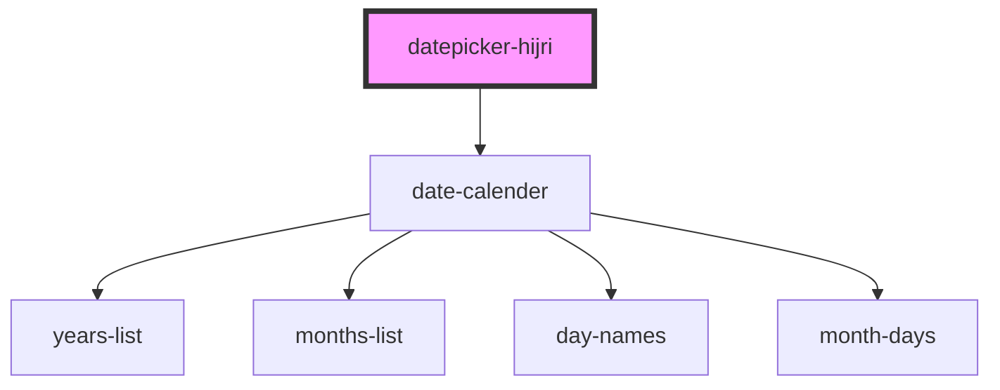

# datepicker-hijri

<!-- Auto Generated Below -->

## Properties

| Property            | Attribute              | Description | Type                                                                                                                                                                                                         | Default           |
| ------------------- | ---------------------- | ----------- | ------------------------------------------------------------------------------------------------------------------------------------------------------------------------------------------------------------ | ----------------- |
| `bgColor`           | `bg-color`             |             | `string`                                                                                                                                                                                                     | `undefined`       |
| `bgcolor`           | `bgcolor`              |             | `string`                                                                                                                                                                                                     | `undefined`       |
| `dateFormat`        | `date-format`          |             | `string`                                                                                                                                                                                                     | `'iYYYY/iMM/iDD'` |
| `disableFuture`     | `disable-future`       |             | `any`                                                                                                                                                                                                        | `false`           |
| `disablePast`       | `disable-past`         |             | `any`                                                                                                                                                                                                        | `false`           |
| `disabled`          | `disabled`             |             | `any`                                                                                                                                                                                                        | `false`           |
| `hideToday`         | `hide-today`           |             | `any`                                                                                                                                                                                                        | `false`           |
| `langCode`          | `lang-code`            |             | `string`                                                                                                                                                                                                     | `'ar'`            |
| `max`               | `max`                  |             | `string`                                                                                                                                                                                                     | `undefined`       |
| `maxDate`           | `max-date`             |             | `string`                                                                                                                                                                                                     | `undefined`       |
| `min`               | `min`                  |             | `string`                                                                                                                                                                                                     | `undefined`       |
| `minDate`           | `min-date`             |             | `string`                                                                                                                                                                                                     | `undefined`       |
| `onDateSelectClose` | `on-date-select-close` |             | `any`                                                                                                                                                                                                        | `true`            |
| `placeholder`       | `placeholder`          |             | `string`                                                                                                                                                                                                     | `undefined`       |
| `placement`         | `placement`            |             | `"auto" \| "auto-end" \| "auto-start" \| "bottom" \| "bottom-end" \| "bottom-start" \| "left" \| "left-end" \| "left-start" \| "right" \| "right-end" \| "right-start" \| "top" \| "top-end" \| "top-start"` | `'bottom'`        |
| `reference`         | `reference`            |             | `string`                                                                                                                                                                                                     | `undefined`       |
| `selectedColor`     | `selected-color`       |             | `string`                                                                                                                                                                                                     | `undefined`       |
| `selectedDate`      | `selected-date`        |             | `string`                                                                                                                                                                                                     | `''`              |
| `selectedTextColor` | `selected-text-color`  |             | `string`                                                                                                                                                                                                     | `undefined`       |
| `textColor`         | `text-color`           |             | `string`                                                                                                                                                                                                     | `undefined`       |
| `todayText`         | `today-text`           |             | `string`                                                                                                                                                                                                     | `undefined`       |
| `zIndex`            | `z-index`              |             | `string`                                                                                                                                                                                                     | `'99999'`         |

## Dependencies

### Depends on

- [date-calender](../date-calender)

### Graph

----------------------------------------------

*Built with [StencilJS](https://stenciljs.com/)*
